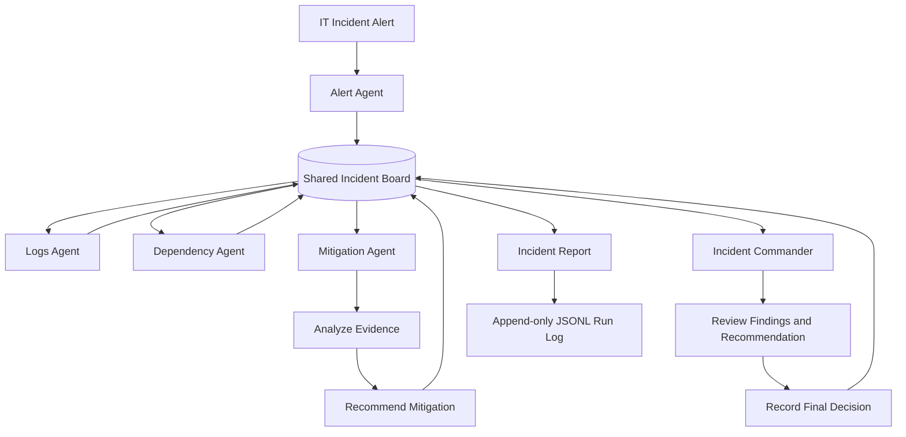

# IT Incident Response War-Room Architecture

## Blackboard Architecture

## Agent Responsibilities

| Agent | Responsibility |
|---|---|
| Alert Agent | Receives and validates incident information |
| Logs Agent | Investigates recent service logs |
| Dependency Agent | Identifies upstream and downstream dependencies |
| Mitigation Agent | Analyzes evidence and recommends an action |
| Incident Commander | Reviews board evidence and records the final decision |

## Shared Blackboard

The Incident Board stores:

- Incident information
- Investigation findings
- Mitigation recommendations
- Final decisions
- Timestamped execution timeline

All investigation and decision-making stages use the same shared Incident Board.

## Technology Stack

- Python
- FastAPI
- Microsoft Semantic Kernel
- Pydantic
- Gemini integration
- JSONL append-only run logging
